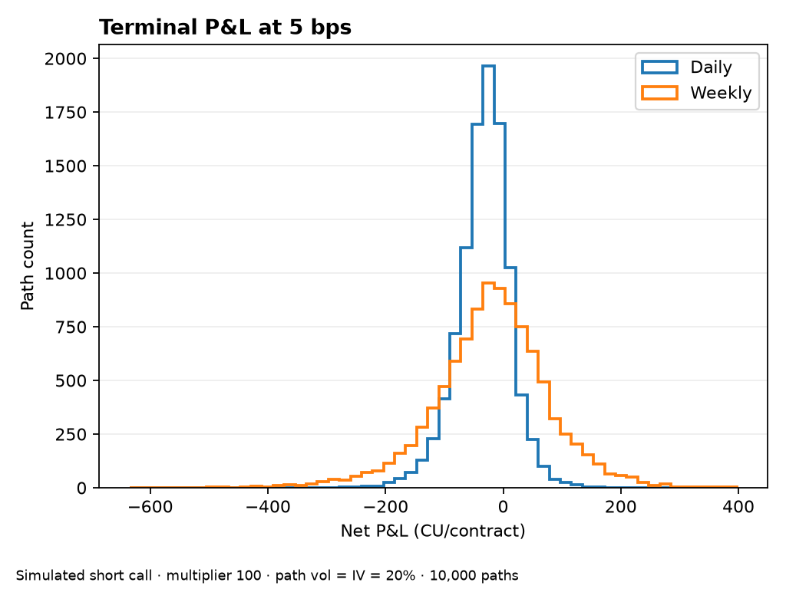

# Options Pricing, Risk & Hedging Analytics

A fictional equity derivatives desk sells one cash-settled European call. How much risk does it retain when it adjusts the stock hedge daily or weekly, and what does the extra trading cost? This Python research package follows the trade from its initial premium through financing, discrete rebalancing and settlement to terminal loss and P&L explain.

**At matched 20% volatility and 5 bps trading cost**, daily rebalancing reduced 95% expected shortfall from 254.44 to 142.23 currency units per contract in 10,000 paired simulated paths. Mean net P&L fell by 12.48. At 30% path volatility and 10 bps, daily hedging still reduced ES, while its net RMSE exceeded weekly RMSE by 21.10. The preferred frequency depends on the desk's risk measure and fee assumptions.



## Install and run

From a clone, use Python 3.11 or 3.12 on Linux or macOS.

```sh
python3 -m venv .venv
source .venv/bin/activate
python -m pip install '.[dev,plots]'
optionlab --help
optionlab price --output pricing
optionlab all --mode fast --output smoke
optionlab all --mode full --output research
python examples/research_figures.py research figures
pytest -q
```

The distribution is `optionlab-analytics`, the import is `optionlab`, and the installed command is `optionlab`. Each CLI invocation writes a new directory and rejects existing destinations. Choose `price`, `mc`, `hedge`, `risk` or `all`. JSON configuration overrides the sampling defaults, for example `{"paths":512,"seed":123}` with `--config settings.json`. Outputs include parameters, seeds, software versions and research data. The optional plots extra supports figure generation from a checkout. Only full default runs reproduce the frozen research budgets.

| Setting | Fast | Full |
|---|---:|---:|
| P paths per volatility | 256 | 10,000 |
| MC convergence repetitions | 2 | 100 |
| Additional MC grid | none | 24 configurations, two methods |
| Paired bootstrap repetitions | 20 | 1,000 |

## Methods and units

- **Pricing.** Immutable EuropeanOption and MarketSnapshot inputs feed price and greeks. Values describe a long option per share. Multiply by signed contracts and contract multiplier for desk exposure. Rates and dividends compound continuously. Vega and rho use unit absolute changes. Theta uses elapsed calendar years. Expiry and zero volatility have deterministic prices and missing Greeks. Integration and finite differences provide numerical validation.
- **Monte Carlo.** Terminal GBM sampling under Q uses drift r−q. Antithetic paths produce independent pair means. Standard errors use the independent observation count. At 100,000 paths the ATM call empirical MSE ratio (antithetic/standard) was 0.510 across 100 repetitions. [MC validation](docs/MC_VALIDATION_REPORT.md)
- **Hedging.** Physical paths use total-return drift μ and a separate path volatility. The short-call desk receives premium, holds fractional stock, accrues financing and dividend cash flows and pays proportional fees including entry and exit. Phase 3 compares the two schedules on shared paths. [Ledger and cost validation](docs/HEDGING_VALIDATION_REPORT.md)
- **Risk.** Loss equals negative net P&L. Empirical VaR uses nearest rank, ES uses fractional tail weights. Bootstrap samples common path IDs. Left-end Greeks approximate option revaluation and preserve a visible residual alongside exact ledger reconciliation. [Risk validation](docs/RISK_VALIDATION_REPORT.md)

The numerical modules in src/optionlab are independent of CLI, file I/O and plotting. The studies orchestrate these APIs and record results. [Architecture](docs/SYSTEM_ARCHITECTURE.md) · [Validation plan](docs/VALIDATION_PLAN.md) · [Release audit](docs/RELEASE_AUDIT.md)

## Reading the research

[MC convergence](docs/figures/convergence.png) · [Variance reduction](docs/figures/variance.png) · [Cost and error](docs/figures/cost.png) · [Tail losses](docs/figures/tail.png) · [P&L contributions](docs/figures/attribution.png)

The models assume European exercise, synthetic GBM paths, continuous borrowing/lending at one rate and proportional trading costs. Stock dividends are discretized and checked for grid convergence. Rare payoffs and finite tail samples limit interval accuracy. Prices, portfolio losses and bootstrap intervals are conditional on model inputs. The studies exclude market impact, order-book execution and live trading.

## Quality and release

CI is configured to lint, check formatting, run the full tests, build sdist and wheel, and smoke-test a clean wheel installation on Python 3.11 and 3.12. Full research is an explicit local run. See the [candidate release notes and checklist](CHANGELOG.md) and [evidence ledger](docs/RESUME_EVIDENCE.md).
